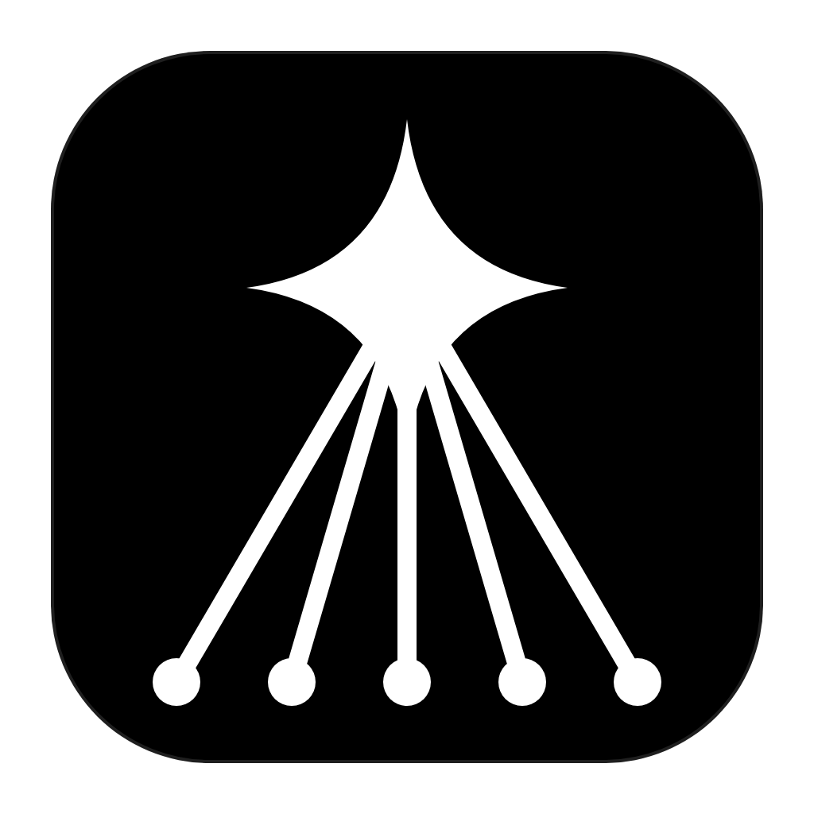
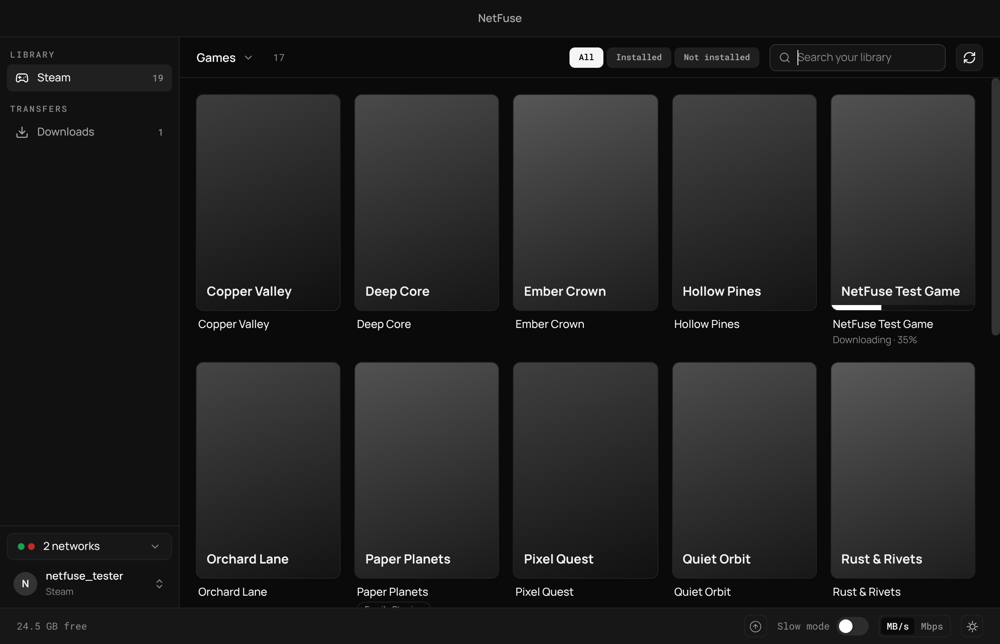
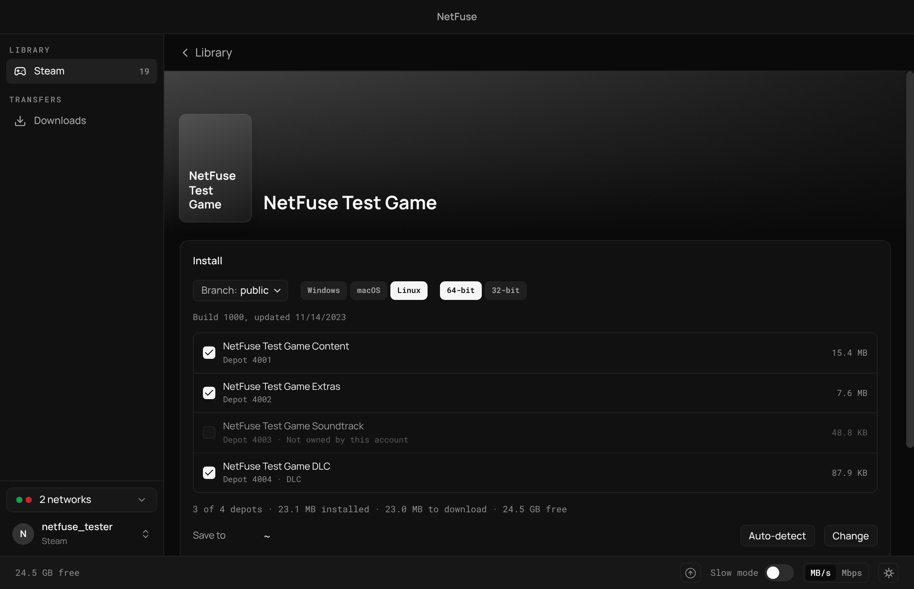
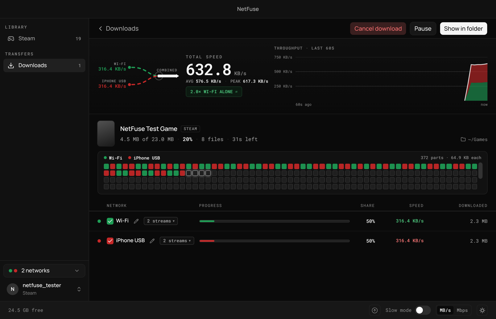

<p align="center">
  
</p>

<h1 align="center">NetFuse</h1>

<p align="center">
  Download your Steam games over every network you have at once.<br>
  Log in, pick a game from your library, and NetFuse fetches it over Wi-Fi, Ethernet and a tethered phone together.
</p>

<p align="center">
  <a href="#how-to-use-it">How to use it</a> ·
  <a href="#install">Install</a> ·
  <a href="#your-account">Your account</a> ·
  <a href="#troubleshooting">Troubleshooting</a> ·
  <a href="#how-it-works">How it works</a> ·
  <a href="#credits">Credits</a>
</p>

<p align="center">
  
  
  <a href="LICENSE"></a>
</p>

<p align="center">
  
</p>

<p align="center">
  
  
</p>

<p align="center"><sub>Shown with sample games from the test suite.</sub></p>

## What it does

- **Your whole Steam library**, by its pictures: games by default, or tools, or both. Search it, and see at a glance what's installed, downloading or installed by Steam itself
- **Every network at once**: a game's chunks are spread across the connections you choose, and faster networks fetch more
- **Log in the way Steam lets you**: account name and password with a Steam Guard code (email or the Steam Mobile App), or a QR code
- **Choose what to install**: branch, system, architecture, language and depots, with download size, install size and free space shown
- **Auto-detect** your Steam libraries' `steamapps/common` folders, on any drive
- **Install over an existing folder**: what's already there and correct is kept, and only what's missing or different is fetched
- **Every chunk is checked** against Steam's manifest before it's written. A damaged copy is fetched again from another server.
- **Pause, resume, quit, lose power**: nothing that was saved is fetched again. Cancelling removes only what the download installed.
- **Speed limits, data allowances, a schedule and a queue**, per network or for everything

## How to use it

1. Open NetFuse and log in to Steam.
2. Pick a game in your library. The depots Steam itself would install are already ticked.
3. Click **Auto-detect** to save it into your Steam library, or **Change** to pick another folder.
4. Click **Download**. Its screen shows each network's share and speed as it goes.
5. In Steam, click **Install** on the game, with the same library selected. Steam finds the files NetFuse downloaded and checks them instead of downloading them again.

## Install

There are no prebuilt installers yet: NetFuse builds from source in a few minutes. You need [Git](https://git-scm.com/) and [Node.js](https://nodejs.org/) 22.13 or later.

```bash
git clone https://github.com/MerikhSS/NetFuse.git
cd NetFuse
npm ci
npm run dev
```

`npm run dev` opens the app straight from the source. To make an installer instead, run the command for your system. The result is in `dist/`.

| System  | Command               | Creates                                     |
| ------- | --------------------- | ------------------------------------------- |
| Windows | `npm run build:win`   | An installer for x64 and ARM64              |
| macOS   | `npm run build:mac`   | `.dmg` packages for Apple silicon and Intel |
| Linux   | `npm run build:linux` | AppImage, `.deb`, `.rpm` and `.tar.gz`      |

Each system's build runs on that system. Local builds are unsigned, so your system warns you the first time you open one.

## Your account

- **Only what you own.** NetFuse downloads only the apps and depots your account is licensed for, Family Sharing included. When Steam turns a depot down, NetFuse says so and stops.
- **No password is kept.** Your password and Steam Guard codes go to Steam once, and are never stored or logged.
- **Staying logged in** keeps only Steam's login token, encrypted with your system's keychain. Without one (some Linux setups), nothing is stored, and you log in each time NetFuse starts.
- **Secrets stay in the background.** The app's window never sees a token, password or depot key.
- **No telemetry.** NetFuse talks only to Steam, the content servers Steam hands out, and Steam's store CDN for the games' pictures.

## Status

This is a preview. Downloads are tested end to end against a stand-in for Steam, which serves real manifests and chunks, and fails the ways real servers do. Known gaps:

- Steam lists a game only after you click **Install** on it in Steam. Having NetFuse register it with Steam is planned.
- Password-protected beta branches aren't supported.
- Steam is the only launcher so far. The window has room for others.

The design and its reasoning are in [docs/steam/DESIGN.md](docs/steam/DESIGN.md). Please report problems in [the issues](https://github.com/MerikhSS/NetFuse/issues).

## Troubleshooting

If your problem isn't covered here, [open an issue](https://github.com/MerikhSS/NetFuse/issues).

<details>
<summary><strong>Steam doesn't list a game NetFuse downloaded</strong></summary>
<br>

Click **Install** on the game in Steam, with the same library selected. Steam finds the files already there, checks them, and fetches only what doesn't match.

</details>

<details>
<summary><strong>A download says "Log in to Steam to continue"</strong></summary>
<br>

The login ended: Steam ended the session, or NetFuse was restarted without **Stay logged in**. Log in again: the download goes on by itself, and nothing already downloaded is lost.

</details>

<details>
<summary><strong>"Stay logged in" can't be ticked</strong></summary>
<br>

NetFuse keeps a login only when your system can encrypt it with its keychain. On Linux, install and unlock a keyring such as GNOME Keyring or KWallet. Without one, you log in each time NetFuse starts.

</details>

<details>
<summary><strong>Windows says "Windows protected your PC"</strong></summary>
<br>

The installer isn't code-signed. Click **More info**, then **Run anyway**.

</details>

<details>
<summary><strong>A second network doesn't make downloads faster</strong></summary>
<br>

NetFuse adds speed only when each network reaches the internet through its own connection. Wi-Fi from your home router plus a phone tethered over USB works. Wi-Fi and Ethernet plugged into the same router doesn't: both share one connection, so the total stays the same.

VPN, virtual, and isolated adapters show up in NetFuse too, so check each network's speed on a download's screen.

</details>

<details>
<summary><strong>A network doesn't appear in NetFuse</strong></summary>
<br>

NetFuse can use any connection your operating system shows as a network adapter.

- **iPhone on macOS**: in **System Settings › Network**, open **iPhone USB** and turn off **Disable unless needed**
- **Android on macOS**: install TetherKit, as described below
- **Phone on Windows**: install your phone maker's driver if the phone doesn't appear in Network Settings

</details>

<details>
<summary><strong>Windows uses only one network</strong></summary>
<br>

If Windows turns Wi-Fi off when Ethernet is plugged in, open the Group Policy Editor (`gpedit.msc`), go to _Computer Configuration_ › _Administrative Templates_ › _Network_ › _Windows Connection Manager_, and set **Minimize the number of simultaneous connections to the Internet or a Windows domain** to **Disabled**.

</details>

<details>
<summary><strong>A network stays idle after reconnecting a phone</strong></summary>
<br>

Pause the download, then resume it.

</details>

<details>
<summary><strong>A game installs slowly to a hard drive</strong></summary>
<br>

NetFuse lowers the streams when the disk can't keep up, and a warning beside the speed says so. Installing to an SSD, or the drive Steam already uses, is faster.

</details>

### Use an Android phone over USB on macOS

macOS has no driver for RNDIS, the protocol Android's USB tethering uses, so the phone charges but no network adapter appears. [TetherKit](https://github.com/XiaoMiku01/TetherKit) is an open-source app that adds one without a kernel extension.

1. Install TetherKit: `brew install XiaoMiku01/tap/tetherkit`
2. Connect your phone over USB.
3. On the phone, open **Settings › Network & internet › Hotspot & tethering** and turn on **USB tethering**.
4. Open TetherKit. On first run, approve its helper with your password.
5. Pick your phone, click **Connect**, then apply the IP settings.
6. Open NetFuse. The phone appears in the networks list.

Thanks to [@XiaoMiku01](https://github.com/XiaoMiku01) for building and open-sourcing TetherKit.

## How it works

NetFuse first fetches each depot's manifest: the list of the game's files and the chunks they're made of. Streams on every selected network then take chunks from a shared queue and fetch them from Steam's content servers, each stream's connection pinned to its own network. Faster networks finish sooner and take more. NetFuse adjusts the number of streams to the network, server and disk, and near the end idle streams race the slowest chunks.

Each chunk is decrypted, decompressed and checked against the manifest in a background thread, then written to every file that contains it. A chunk shared by several files is fetched once. Progress is saved every 15 seconds, after the files are flushed to disk, so a chunk counted as done is really there.

Each network needs its own internet connection to add bandwidth. NetFuse combines connections for its own downloads and needs no VPN or virtual network adapter.

## Development

| Command                  | What it does                                                |
| ------------------------ | ----------------------------------------------------------- |
| `npm run dev`            | Runs the app from the source                                |
| `npm run test:e2e:smoke` | Playwright smoke tests                                      |
| `npm run test:e2e`       | The full end-to-end suite, against a stand-in for Steam     |
| `npm run build:unpack`   | Creates an unpacked app for the current platform in `dist/` |

[CONTRIBUTING.md](CONTRIBUTING.md) covers setup, the required checks and packaging.

## Credits

- Steam's protocol is handled by [steam-user](https://github.com/DoctorMcKay/node-steam-user) and [steam-session](https://github.com/DoctorMcKay/node-steam-session) by Alex Corn.

Steam is a trademark of Valve Corporation. NetFuse isn't affiliated with or endorsed by Valve.

## License

[MIT](LICENSE)
